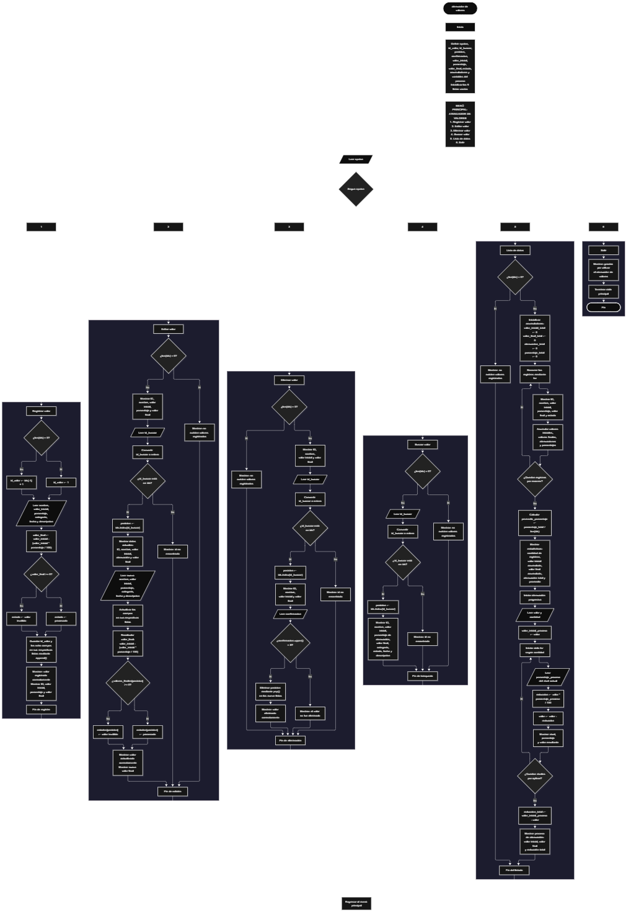

Este proyecto, llamado <b>atenuador de valores</b>, fue desarrollado en <b>python</b> como un ejercicio práctico para fortalecer la lógica de programación mediante la creación de un sistema de gestión y procesamiento de valores desde la consola. El programa cuenta con un menú principal de seis opciones que permite <b>registrar, editar, eliminar, buscar y listar valores</b>, además de realizar un proceso de atenuación progresiva. Cada registro almacena información como el nombre, el valor inicial, el porcentaje de atenuación, el valor final, la categoría, el estado, la fecha y la descripción, utilizando nueve listas paralelas que permiten administrar los datos durante la ejecución. Durante su desarrollo se aplicaron conceptos fundamentales de programación, como variables, listas, estructuras condicionales, ciclos repetitivos, operaciones aritméticas, acumuladores y cálculos de porcentajes. Este proyecto permite poner en práctica los conocimientos adquiridos en python y sirve como base para desarrollar sistemas de procesamiento y gestión de información más avanzados utilizando otros lenguajes y tecnologías.

<h2 align="center">⚙️ Funcionamiento del menú principal</h2>

### ➕ Registrar valor

La opción <b>1) registrar valor</b> permite almacenar un nuevo registro dentro del atenuador de valores. Antes de comenzar, el programa genera automáticamente un identificador mediante la condición <b>len(ids) == 0</b>. Si la lista está vacía, asigna el valor <b>1</b> a la variable <b>id_valor</b>; en caso contrario, obtiene el último identificador almacenado mediante <b>ids[-1] + 1</b>. Después, solicita el <b>nombre, valor inicial, porcentaje de atenuación, categoría, fecha y descripción</b>. Para calcular el resultado, utiliza la operación <b>valor_inicial - (valor_inicial * porcentaje / 100)</b>, almacenando el resultado en la variable <b>valor_final</b>. Posteriormente, comprueba si el valor final es mayor o igual a cero. Si se cumple esta condición, establece el estado <b>"procesado"</b>; de lo contrario, asigna <b>"valor inválido"</b>. Finalmente, almacena el identificador y los ocho campos correspondientes mediante el método <b>append()</b> en sus respectivas listas, mostrando el mensaje <b>"valor registrado correctamente."</b>, el ID generado, el valor inicial, el porcentaje aplicado y el resultado final.

### ✏️ Editar valor

La opción <b>2) editar valor</b> permite modificar la información de un registro existente. Primero, el programa comprueba si la lista <b>ids</b> está vacía mediante la condición <b>len(ids) == 0</b>. Si no existen registros, muestra el mensaje <b>"no existen valores registrados."</b>. En caso contrario, presenta una lista con el identificador, nombre, valor inicial, porcentaje de atenuación y valor final de cada registro. Después, solicita el ID del valor que se desea editar, convirtiendo la entrada mediante <b>int()</b> y comprobando si el identificador se encuentra dentro de la lista <b>ids</b>. Si existe, utiliza <b>ids.index(id_buscar)</b> para obtener su posición y mostrar los datos actuales. A continuación, solicita el nuevo nombre, valor inicial, porcentaje de atenuación, categoría, fecha y descripción, actualizando directamente los datos en sus respectivas listas. Una vez modificada la información, vuelve a calcular el valor final y determina nuevamente el estado mediante la condición <b>valores_finales[posicion] &gt;= 0</b>. Si el resultado es válido, establece <b>"procesado"</b>; de lo contrario, asigna <b>"valor inválido"</b>. Finalmente, muestra el mensaje <b>"valor actualizado correctamente."</b> y el nuevo valor final. Si el ID introducido no corresponde a ningún registro, presenta el mensaje <b>"id no encontrada."</b>.

### 🗑️ Eliminar valor

La opción <b>3) eliminar valor</b> permite eliminar un registro almacenado mediante su identificador. Antes de comenzar, el programa comprueba si existen valores registrados. Si la lista <b>ids</b> está vacía, muestra el mensaje <b>"no existen valores registrados."</b>. Si hay registros disponibles, presenta una lista con el ID, nombre, valor inicial y valor final de cada uno. Después, solicita el identificador que se desea eliminar, convirtiéndolo mediante <b>int()</b> y comprobando si se encuentra en la lista <b>ids</b>. Si el registro existe, utiliza <b>ids.index(id_buscar)</b> para localizar su posición y muestra el identificador, nombre, valor inicial y valor final correspondientes. A continuación, solicita una confirmación mediante la entrada <b>confirmacion</b>. Si el usuario introduce la letra <b>"S"</b>, el programa elimina los datos de esa posición utilizando el método <b>pop(posicion)</b> en las nueve listas: <b>ids, nombres, valores_iniciales, porcentajes, valores_finales, categorias, estados, fechas y descripciones</b>. De esta manera, mantiene sincronizada la información de todos los registros. Finalmente, muestra el mensaje <b>"valor eliminado correctamente."</b>. Si el usuario no confirma la operación, presenta el mensaje <b>"el valor no fue eliminado."</b>. Si el identificador no existe, muestra <b>"id no encontrada."</b>.

### 🔎 Buscar valor

La opción <b>4) buscar valor</b> permite localizar un registro específico mediante su identificador. Primero, el programa comprueba si existen valores almacenados. Si la lista <b>ids</b> está vacía, presenta el mensaje <b>"no existen valores registrados."</b>. En caso contrario, solicita el ID del registro que se desea buscar y convierte la entrada mediante <b>int()</b>. Después, comprueba si el identificador introducido se encuentra en la lista <b>ids</b>. Cuando existe una coincidencia, utiliza <b>ids.index(id_buscar)</b> para obtener la posición correspondiente y mostrar toda la información del registro: <b>ID, nombre, valor inicial, porcentaje de atenuación, valor final, categoría, estado, fecha y descripción</b>. Si el identificador no se encuentra entre los registros almacenados, presenta el mensaje <b>"id no encontrada."</b>. Esta función facilita consultar la información completa de un valor sin necesidad de recorrer manualmente todos los registros.

### 📋 Lista de datos

La opción <b>5) lista de datos</b> permite visualizar los registros almacenados y obtener estadísticas generales del atenuador de valores. Antes de realizar el proceso, el programa comprueba si existen registros mediante la condición <b>len(ids) == 0</b>. Si la lista está vacía, muestra el mensaje <b>"no existen valores registrados."</b>. En caso contrario, inicializa los acumuladores <b>valor_inicial_total, valor_final_total, atenuacion_total y porcentaje_total</b> con el valor <b>0</b>. Posteriormente, utiliza un ciclo <b>for</b> para recorrer los registros y mostrar el ID, nombre, valor inicial, porcentaje de atenuación, valor final y estado de cada uno. Durante el recorrido, acumula los valores iniciales, los valores finales y las reducciones obtenidas mediante la diferencia entre el valor inicial y el valor final. También suma los porcentajes de atenuación aplicados. Al finalizar, calcula el promedio de los porcentajes mediante la operación <b>porcentaje_total / len(ids)</b> y presenta las estadísticas generales: cantidad de registros, valor inicial acumulado, valor final acumulado, atenuación total y promedio de atenuación. Esta funcionalidad permite conocer el comportamiento general de los valores procesados y consultar sus resultados acumulados.

### 📉 Atenuación progresiva

Dentro de la opción <b>5) lista de datos</b> se encuentra integrado un proceso adicional denominado <b>atenuación progresiva</b>, que permite aplicar varios porcentajes de reducción consecutivos sobre un mismo valor. Primero, el programa solicita el valor que se desea atenuar mediante la variable <b>valor</b> y la cantidad de atenuaciones que se aplicarán mediante la variable <b>cantidad</b>. Después, conserva el valor original en <b>valor_inicial_proceso</b> y utiliza un ciclo <b>for</b> para repetir el procedimiento según la cantidad de niveles indicada. En cada repetición, solicita un porcentaje de atenuación mediante la variable <b>porcentaje_proceso</b>, calcula la reducción utilizando la operación <b>valor * porcentaje_proceso / 100</b> y almacena el resultado en la variable <b>reduccion</b>. Posteriormente, actualiza el valor mediante <b>valor = valor - reduccion</b>, de manera que cada nuevo porcentaje se aplica sobre el resultado obtenido en el nivel anterior. Durante el proceso, muestra el número del nivel, el porcentaje aplicado y el valor resultante. Al finalizar el ciclo, calcula la reducción total mediante la diferencia entre <b>valor_inicial_proceso</b> y <b>valor</b>. Finalmente, presenta el valor inicial, el valor final y la reducción total del procedimiento. Esta funcionalidad permite observar cómo cambia progresivamente un valor al aplicar diferentes porcentajes de atenuación. El resultado de este proceso es independiente de los registros almacenados y no modifica las listas principales del programa.

### 🚪 Salir del menú principal

La opción <b>6) salir</b> está destinada a finalizar la ejecución del programa y muestra el mensaje <b>"gracias por utilizar el atenuador de valores."</b>. El menú principal se encuentra dentro de un ciclo repetitivo <b>while True</b>, que mantiene el programa en funcionamiento mientras el usuario realiza las diferentes operaciones disponibles. Cuando se selecciona la opción <b>6</b>, el programa ejecuta la instrucción <b>break</b>, que interrumpe el ciclo principal y finaliza la ejecución del sistema. Si se introduce una opción diferente de las seis disponibles, muestra el mensaje <b>"opción no válida."</b>.

<h2 align="center">🧠 Temas aplicados en el proyecto</h2>

### 📦 Variables

En este proyecto se utilizan variables para almacenar los datos introducidos por el usuario, controlar las opciones del menú, identificar la posición de los registros, realizar operaciones matemáticas y acumular los resultados estadísticos. Cada variable cumple una función específica dentro de los procesos de gestión y atenuación de valores.

🔢 **Opcion:** Almacena la opción seleccionada por el usuario en el menú principal.

🆔 **Id_valor:** Almacena el identificador generado para cada nuevo registro.

📝 **Nombre:** Almacena el nombre del valor registrado.

📊 **Valor_inicial:** Almacena el valor original antes de aplicar la atenuación.

📉 **Porcentaje:** Almacena el porcentaje de atenuación que se desea aplicar.

🧮 **Valor_final:** Almacena el resultado obtenido después de aplicar la reducción porcentual.

📂 **Categoria:** Almacena la categoría asignada al registro.

📅 **Fecha:** Almacena la fecha introducida para el registro.

📄 **Descripcion:** Almacena la descripción correspondiente al valor.

🔎 **Id_buscar:** Almacena el identificador introducido para localizar un registro.

🔄 **Posicion:** Indica la posición del registro encontrado dentro de las listas.

✅ **Estado:** Almacena el resultado del procesamiento, que puede ser procesado o valor inválido.

📊 **Valor_inicial_total:** Acumula la suma de los valores iniciales de los registros.

📈 **Valor_final_total:** Acumula la suma de los valores finales de los registros.

📉 **Atenuacion_total:** Acumula las reducciones obtenidas en los registros.

🔢 **Porcentaje_total:** Acumula los porcentajes de atenuación utilizados.

📊 **Promedio_porcentaje:** Almacena el promedio de los porcentajes de atenuación.

🔁 **Valor:** Almacena el resultado actualizado durante el proceso de atenuación progresiva.

🔢 **Cantidad:** Indica cuántos niveles de atenuación progresiva se aplicarán.

📉 **Porcentaje_proceso:** Almacena el porcentaje correspondiente a cada nivel de atenuación progresiva.

🧮 **Reduccion:** Almacena la cantidad que se resta en cada nivel del proceso progresivo.

📌 **Valor_inicial_proceso:** Conserva el valor original utilizado para calcular la reducción total del proceso progresivo.

### 🗃️ Listas

En este proyecto se utilizan nueve listas relacionadas con la información de cada valor registrado. Todas comparten la misma posición para representar los datos correspondientes a un mismo registro. Por ejemplo, la información almacenada en la posición <b>0</b> se encuentra distribuida entre <b>ids[0], nombres[0], valores_iniciales[0], porcentajes[0], valores_finales[0], categorias[0], estados[0], fechas[0] y descripciones[0]</b>. Esta organización permite almacenar, recorrer, buscar, modificar, mostrar y eliminar los registros de manera ordenada mediante sus índices correspondientes.

🆔 **Ids:** Almacena los identificadores únicos asignados a los registros durante su creación.

📝 **Nombres:** Almacena los nombres de los valores registrados.

🔢 **Valores_iniciales:** Almacena los valores originales antes de aplicar los porcentajes de atenuación.

📉 **Porcentajes:** Almacena los porcentajes de atenuación correspondientes a cada registro.

🧮 **Valores_finales:** Almacena los resultados calculados después de aplicar la atenuación.

📂 **Categorias:** Almacena las categorías asignadas a los valores registrados.

📊 **Estados:** Almacena el estado de cada registro, indicando si fue procesado o si su valor final es inválido.

📅 **Fechas:** Almacena las fechas correspondientes a cada registro.

📄 **Descripciones:** Almacena las descripciones de los valores registrados.

### 🔀 Estructuras condicionales

En este proyecto se utilizan las estructuras <b>if</b>, <b>elif</b> y <b>else</b> para controlar las diferentes operaciones del menú principal y comprobar las condiciones necesarias durante el procesamiento de los valores. Estas estructuras permiten determinar si existen registros antes de realizar una operación, verificar si un identificador se encuentra almacenado, comprobar si el usuario confirma una eliminación y establecer el estado correspondiente según el resultado de la atenuación. También permiten identificar cuándo una opción introducida no coincide con las alternativas disponibles en el menú.

### 🔄 Estructuras repetitivas

En este proyecto se utilizan los ciclos <b>while</b> y <b>for</b>. El ciclo <b>while True</b> mantiene activo el menú principal y permite ejecutar diferentes operaciones hasta que el usuario selecciona la opción de salida. Por otro lado, los ciclos <b>for</b> permiten recorrer las listas para mostrar los registros almacenados y realizar los cálculos estadísticos correspondientes. También se utiliza un ciclo <b>for</b> dentro del proceso de atenuación progresiva para aplicar consecutivamente los porcentajes indicados por el usuario, actualizando el resultado en cada nivel.

### 🎯 Operaciones aritméticas

El programa utiliza operaciones aritméticas para calcular los resultados de la atenuación y obtener las estadísticas de los registros. La resta permite calcular la reducción aplicada a un valor, la multiplicación permite obtener la cantidad correspondiente al porcentaje de atenuación y la división permite calcular el porcentaje aplicado sobre el valor inicial y obtener el promedio de los porcentajes registrados. Estas operaciones se utilizan tanto en el registro y edición de valores como en el proceso de atenuación progresiva.

### 📊 Acumuladores

Los acumuladores se utilizan dentro de la opción <b>5) lista de datos</b> para sumar los resultados de todos los registros almacenados. Antes de iniciar el recorrido, las variables <b>valor_inicial_total, valor_final_total, atenuacion_total y porcentaje_total</b> se inicializan en cero. Durante el ciclo <b>for</b>, cada registro aporta sus valores correspondientes a los acumuladores. De esta manera, el programa obtiene la suma de los valores iniciales, la suma de los valores finales, la reducción total y la suma de los porcentajes de atenuación.

### 📐 Cálculo de porcentajes

El cálculo de porcentajes constituye una de las operaciones principales del proyecto. Para obtener la reducción correspondiente a un porcentaje de atenuación, el programa multiplica el valor por el porcentaje y divide el resultado entre <b>100</b>. Posteriormente, resta esa cantidad al valor original para obtener el resultado final. Esta operación se utiliza durante el registro, la edición y la atenuación progresiva, permitiendo procesar valores mediante reducciones porcentuales.

### 📈 Cálculo de promedios

El programa calcula el promedio de los porcentajes de atenuación aplicados a los registros almacenados. Para realizar este procedimiento, acumula todos los porcentajes en la variable <b>porcentaje_total</b> y posteriormente divide esa suma entre la cantidad de registros mediante <b>len(ids)</b>. El resultado se almacena en <b>promedio_porcentaje</b> y se presenta junto con las demás estadísticas del sistema. Este cálculo permite conocer el porcentaje promedio de atenuación utilizado en los valores registrados.

### 🔢 Conversión de datos

En este proyecto se utilizan las funciones <b>float()</b> e <b>int()</b> para convertir los datos introducidos por el usuario al tipo de dato necesario para cada operación. La función <b>float()</b> se utiliza para recibir valores iniciales, porcentajes de atenuación y cantidades numéricas que requieren operaciones decimales. Por otro lado, <b>int()</b> permite convertir los identificadores y la cantidad de niveles del proceso de atenuación progresiva en números enteros. Estas conversiones permiten trabajar con los datos de acuerdo con las operaciones que realiza el programa.

<h2 align="center">¿Cómo se implementaron las operaciones crud en el proyecto?</h2>

Las operaciones <b>crud</b> se implementaron mediante las opciones del menú principal, permitiendo administrar los valores registrados. La operación <b>crear</b> corresponde a <b>registrar valor</b>, donde se introducen los datos de un nuevo registro y se calcula su valor final; <b>leer</b> se realiza mediante las opciones <b>buscar valor y lista de datos</b>, que permiten consultar la información individual y visualizar los registros almacenados; <b>actualizar</b> corresponde a <b>editar valor</b>, donde se modifican los datos de un registro existente y se recalcula su resultado; y <b>eliminar</b> se realiza mediante la opción <b>eliminar valor</b>, que permite quitar un registro de las listas después de confirmar la operación. Estas funcionalidades utilizan listas paralelas, variables, estructuras condicionales y ciclos para gestionar la información almacenada temporalmente durante la ejecución del programa.

<h2 align="center">Diagrama de flujo del proyecto</h2>

<h2 align="center">🛡️ Validaciones del programa</h2>

### 📭 No existen valores registrados

Esta comprobación se utiliza en las opciones de <b>editar, eliminar, buscar y lista de datos</b>. El programa verifica si la lista <b>ids</b> tiene una longitud igual a <b>0</b> mediante la condición <b>len(ids) == 0</b>. Si no existen registros almacenados, muestra el mensaje <b>"no existen valores registrados."</b> y evita continuar con las operaciones que necesitan información previamente registrada.

### ❌ Valor no encontrado

Esta comprobación se utiliza durante las operaciones de <b>editar, eliminar y buscar valor</b>. El programa solicita un identificador y comprueba si se encuentra dentro de la lista <b>ids</b> mediante la condición <b>id_buscar in ids</b>. Si existe una coincidencia, utiliza <b>ids.index(id_buscar)</b> para localizar la posición correspondiente y continuar con la operación. Si el identificador no se encuentra almacenado, muestra el mensaje <b>"id no encontrada."</b>.

### 📉 Estado del valor final

Esta comprobación se utiliza durante el registro y la edición de los valores para determinar el estado del resultado obtenido después de aplicar el porcentaje de atenuación. El programa comprueba si el valor final es mayor o igual a <b>0</b> mediante la condición <b>valor_final &gt;= 0</b>. Si se cumple, establece el estado <b>"procesado"</b>; en caso contrario, asigna <b>"valor inválido"</b>. De esta manera, el programa identifica los resultados negativos y los diferencia de aquellos que no presentan un valor final negativo.

### ⚠️ Confirmación de eliminación

Esta comprobación se utiliza durante la opción <b>3) eliminar valor</b>. Después de localizar el registro y mostrar sus datos, el programa solicita una confirmación mediante la variable <b>confirmacion</b>. Utiliza el método <b>upper()</b> para convertir la respuesta a mayúsculas y comprobar si es igual a <b>"S"</b>. Si el usuario confirma la operación, elimina la información correspondiente mediante <b>pop(posicion)</b> en las nueve listas. Si introduce otra respuesta, el programa cancela la eliminación y muestra el mensaje <b>"el valor no fue eliminado."</b>.

### ⚠️ Opción inválida

El menú principal utiliza una estructura condicional <b>if, elif y else</b> para identificar la opción seleccionada por el usuario. Las opciones del <b>1</b> al <b>6</b> corresponden a las operaciones disponibles en el programa. Si el usuario introduce un valor diferente de las opciones definidas, se ejecuta el bloque <b>else</b> y se muestra el mensaje <b>"opción no válida."</b>.

### ⚠️ Limitaciones en la entrada de datos

El programa utiliza las funciones <b>int()</b> y <b>float()</b> para convertir los datos introducidos por el usuario, pero no implementa estructuras de manejo de excepciones para controlar entradas que no correspondan al tipo de dato esperado. Tampoco comprueba que los campos de texto estén completos, que las fechas tengan un formato específico o que los porcentajes se encuentren dentro de un intervalo determinado. Por lo tanto, estas condiciones no están validadas en la versión actual del programa.

### 📊 Proceso de atenuación progresiva

El proceso de atenuación progresiva utiliza las variables <b>valor</b> y <b>cantidad</b> para realizar diferentes niveles de reducción sobre un mismo valor. El ciclo <b>for</b> repite el procedimiento según la cantidad introducida por el usuario. Sin embargo, el programa no incorpora una validación específica para impedir cantidades negativas o porcentajes fuera de un intervalo determinado. Además, este proceso funciona de manera independiente de los registros almacenados y sus resultados no se guardan en las nueve listas principales.

<h2 align="center">🎯 Objetivo del proyecto</h2>

El objetivo principal de este proyecto es fortalecer la <b>lógica de programación</b> mediante el desarrollo de un sistema de gestión y procesamiento de valores en <b>python</b>. A través de su construcción se busca aplicar los conocimientos adquiridos sobre variables, listas, estructuras condicionales, ciclos repetitivos y operaciones aritméticas, integrándolos para resolver un problema de manera organizada. Además, el proyecto permite comprender cómo registrar, consultar, modificar y eliminar información, realizar cálculos porcentuales, utilizar acumuladores y obtener estadísticas generales. También permite poner en práctica el procesamiento progresivo de valores mediante la aplicación consecutiva de diferentes porcentajes de atenuación, estableciendo una base para desarrollar sistemas de cálculo y gestión más completos con otros lenguajes y tecnologías.

